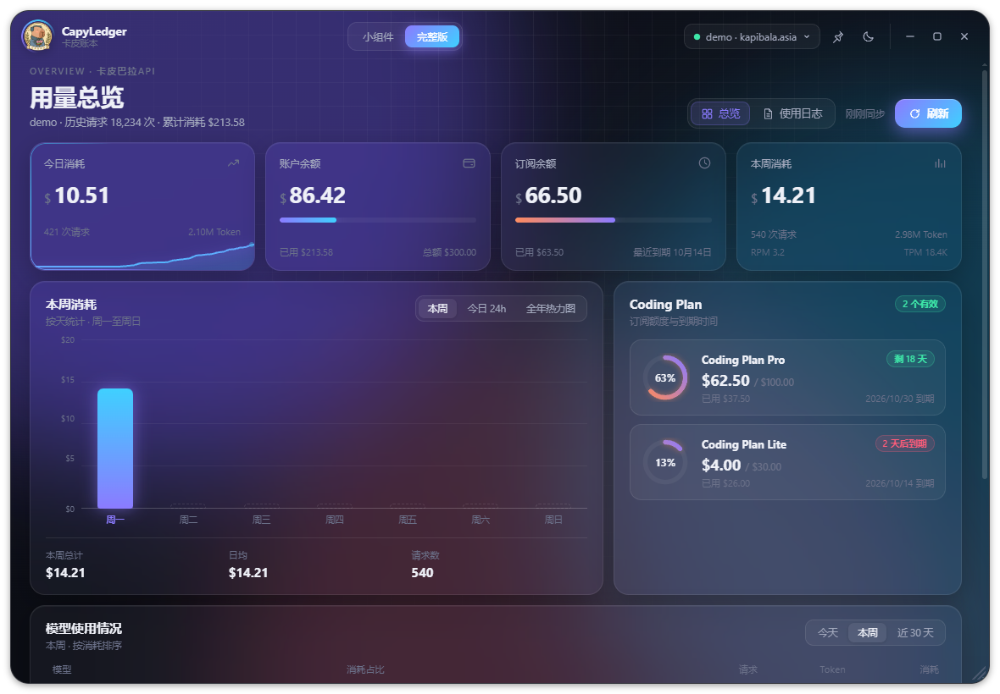
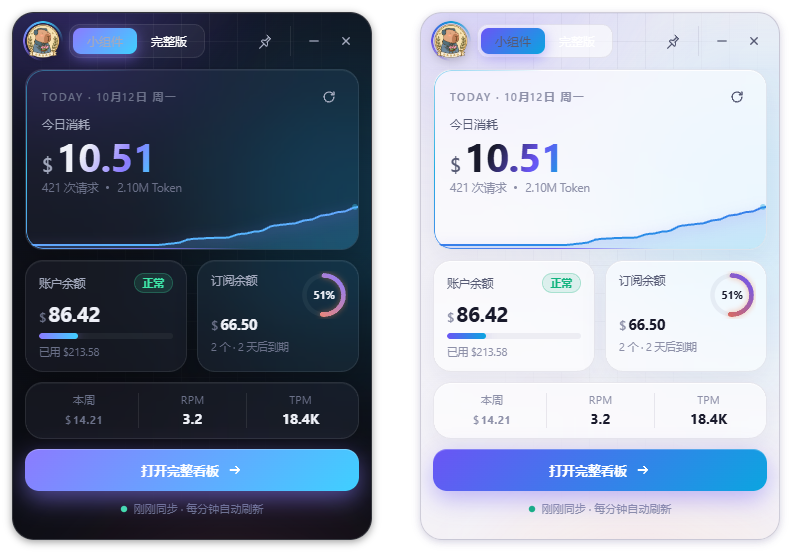
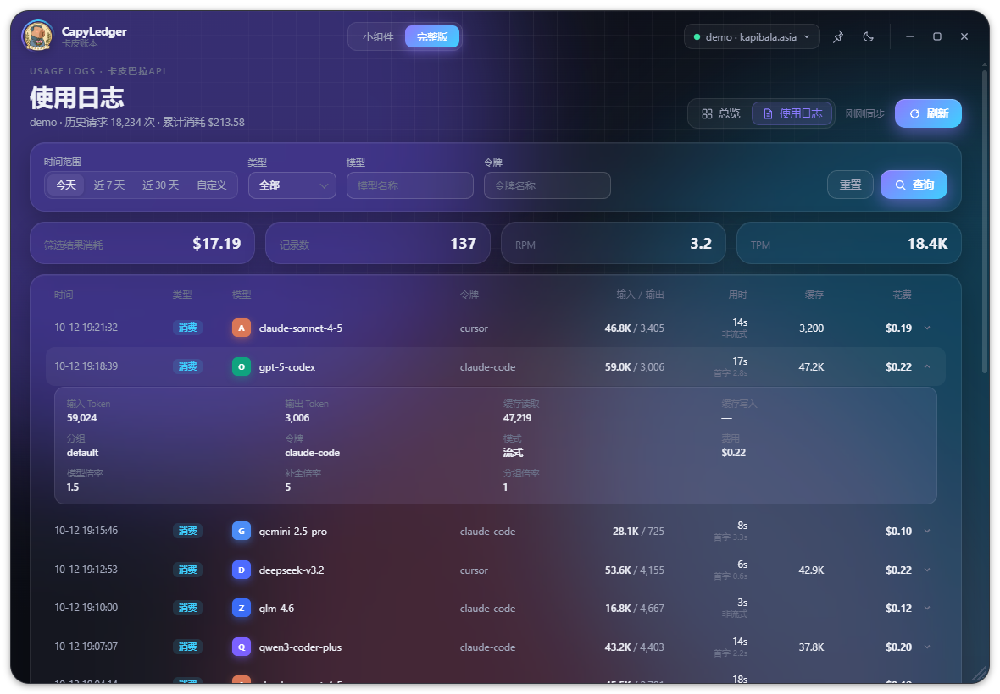
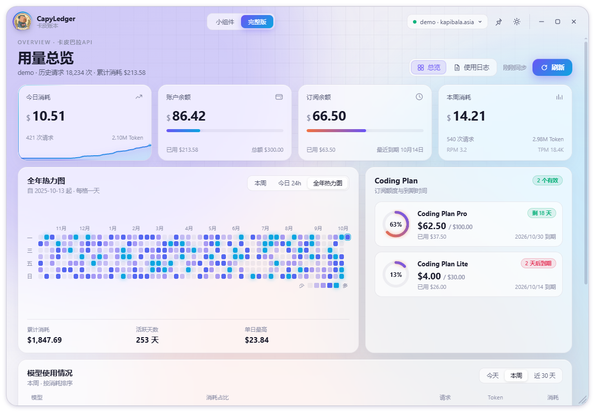

<div align="center">


# CapyLedger · 卡皮账本

**一个好看、透明、可审计的中转站余额与用量看板**

适用于 [Kapibala](https://kapibala.asia) 及所有基于 [New API](https://github.com/QuantumNous/new-api) 的 AI 中转站

Windows 10 / 11 · Electron · MIT License

</div>

---



## 为什么做这个

市面上的中转站余额小工具大多是别人打包好的 exe，用户要把账号密码交给一个看不到源码的程序，心里难免不踏实。

CapyLedger 的出发点很简单：**代码全部公开、所有网络请求集中在一个文件里、谁都能自己审查、自己打包**。

## 功能一览

| 小组件模式 | 完整看板 |
| --- | --- |
| 今日消耗 + 当日累计曲线 | 今日 / 余额 / 订阅 / 本周 四张数据卡片 |
| 账户余额与使用进度 | 本周按天、今日按小时柱状图 |
| 订阅（Coding Plan）剩余比例环 | 近一年每日消耗热力图 |
| 本周消耗、实时 RPM / TPM | Coding Plan 订阅列表与到期提醒 |
| 一键展开完整看板 | 模型使用排行（今天 / 本周 / 近 30 天） |
| | **使用日志**：筛选、分页、展开查看倍率与缓存明细 |

还有：

- 🌗 **深色 / 浅色主题**，点击按钮从按钮位置圆形扩散切换
- ✨ 极光流动背景、旋转光环描边、鼠标跟随高光、数字滚动、进度条流光
- 📌 窗口置顶、托盘常驻、开机自启（托盘右键菜单）
- 🔄 每分钟自动刷新；短期令牌自动续期；断网时显示上次缓存
- 💱 金额按站点配置自动换算（美元 / 人民币 / 自定义货币），与网页控制台一致

<p align="center">
  
</p>

<p align="center">
  
  
</p>

## 快速开始（普通用户）

1. 到 [Releases](../../releases) 页面下载 `CapyLedger x.x.x.exe`（免安装单文件）。
2. 双击运行。首次运行若出现「Windows 已保护你的电脑」，点 **更多信息 → 仍要运行**（程序没有购买商业代码签名证书，这是正常提示）。
3. 在登录窗口填写：
   - **站点地址**：默认 `https://kapibala.asia`，其它 New API 中转站填它的网址即可
   - **账号密码** 登录；或切换到 **访问令牌** 登录（见下文）
4. 登录成功后即可看到数据。点击顶部「小组件 / 完整版」切换视图。

> 首次启动需要解压，大约 2–3 秒后窗口才出现，属于正常现象。

### 两种登录方式

| 方式 | 适用场景 | 填写内容 |
| --- | --- | --- |
| 账号密码 | 大多数情况 | 站点账号和密码。可勾选「记住密码」，会话过期时自动重新登录 |
| 访问令牌 | 账户开启了两步验证，或不想在本机保存密码 | 站点 **个人设置 → 安全设置** 里生成的「系统访问令牌」，以及个人设置页显示的数字 **用户 ID** |

> 注意：「访问令牌」不是你调用 API 用的 `sk-...` 密钥，而是用于读取账户信息的系统令牌。

### 常用操作

| 操作 | 方法 |
| --- | --- |
| 手动刷新 | 点刷新按钮，或按 `F5` / `Ctrl + R` |
| 切换主题 | 完整版右上角 🌙 / ☀️ 按钮 |
| 窗口置顶 | 顶栏图钉按钮，或托盘右键「窗口置顶」 |
| 开机自启 | 托盘右键「开机自启」 |
| 隐藏 / 显示 | 点 × 会隐藏到托盘；单击托盘图标重新显示 |
| 彻底退出 | 托盘右键「退出」 |
| 调整大小 | 完整版右下角拖动；□ 按钮铺满屏幕 |
| 查看日志明细 | 完整版右上角切换到「使用日志」，点击任意一行展开 |
| 切换账户 / 退出登录 | 点顶栏账户胶囊，打开菜单 |

## 安全与隐私

这是本项目最重要的部分，欢迎任何人审查。

| 项目 | 做法 |
| --- | --- |
| 网络请求 | **全部集中在 [`src/client.cjs`](src/client.cjs)**，只会访问你填写的站点地址。没有遥测、没有统计、没有自动更新、没有第三方服务 |
| 界面隔离 | 界面层通过 CSP `connect-src 'none'` 禁止联网，主进程还会拦截所有非本地文件请求，界面代码即使被篡改也无法向外发数据 |
| 凭据存储 | 使用 Windows DPAPI（Electron `safeStorage`）加密，只有当前 Windows 用户能解密；不勾选「记住密码」则不保存密码 |
| 传输安全 | 远程站点强制 HTTPS，并禁止重定向，防止令牌被转发到其他域名 |
| 进程权限 | 开启 `sandbox` + `contextIsolation`，关闭 `nodeIntegration`；拒绝一切浏览器权限申请，禁止页面跳转与弹窗 |
| 退出登录 | 删除本地凭据与用量缓存 |

**用到的接口**（均为 New API 标准接口，只读，除登录外不会修改任何数据）：

```
GET  /api/status              站点公共配置（货币与换算比例）
POST /api/user/login          账号密码登录
POST /api/user/auth/refresh   短期令牌续期（站点不支持时自动跳过）
GET  /api/user/self           账户余额
GET  /api/subscription/self   订阅（Coding Plan）
GET  /api/subscription/plans  订阅名称
GET  /api/log/self/stat       实时消耗、RPM / TPM
GET  /api/data/self           按小时聚合的历史用量（热力图、模型统计）
GET  /api/log/self            使用日志
```

**本地数据位置**：`%APPDATA%\CapyLedger\`

| 文件 | 内容 |
| --- | --- |
| `credentials.bin` | 加密后的登录凭据 |
| `usage-cache.json` | 用量缓存（不含凭据） |
| `settings.json` | 窗口位置、主题等设置 |

想彻底清除：在软件里「退出登录」，或直接删除上面这个文件夹。

## 从源码运行 / 自己打包

如果你不想信任任何别人打包的 exe（包括本项目 Releases 里的），可以自己从源码构建。

**环境要求**：Windows 10 / 11、[Node.js](https://nodejs.org) 20 或更高版本

```bash
git clone https://github.com/lbwnv/lbw.git
cd lbw
npm install
```

```bash
npm start
```

```bash
npm test
```

```bash
npm run dist
```

- `npm start`：开发模式运行
- `npm test`：端到端测试。会在本机启动一个模拟的 New API 站点，测试登录、刷新、令牌续期、日志、离线缓存、退出清除等流程，**不会访问任何真实站点**
- `npm run dist`：打包为 `dist/CapyLedger x.x.x.exe`（免安装单文件）

> 国内网络下载 Electron 较慢时，可以先设置镜像再安装：
> ```bash
> npm config set registry https://registry.npmmirror.com
> ```
> ```bash
> set ELECTRON_MIRROR=https://npmmirror.com/mirrors/electron/
> ```

## 项目结构

```
src/
├─ main.cjs            主进程：窗口、托盘、权限锁定、IPC
├─ preload.cjs         暴露给界面的有限 API（仅此而已）
├─ client.cjs          唯一的网络层：New API 客户端、凭据加密、缓存
├─ renderer/
│  ├─ index.html       界面结构（带严格 CSP）
│  ├─ styles.css       主题、动效
│  └─ app.js           界面逻辑（直接用浏览器打开会进入演示模式）
└─ assets/             图标与 logo
test/
└─ e2e.cjs             端到端测试（本地模拟站点）
```

> 小技巧：直接在浏览器里打开 `src/renderer/index.html`，会使用内置演示数据，方便调整界面样式。

## 常见问题

**Q：登录提示「该账户开启了两步验证」？**
改用「访问令牌」方式登录。

**Q：登录失败，提示人机验证相关错误？**
如果站点开启了 Turnstile 人机验证，账号密码登录无法通过，请改用「访问令牌」方式。

**Q：金额和网页上显示的不一样？**
本软件按站点 `/api/status` 返回的换算比例和货币类型计算，与网页控制台一致。今日 / 本周消耗来自实时统计接口；热力图和模型统计来自按小时聚合的数据，可能有几分钟延迟。

**Q：提示「历史用量暂未同步」？**
部分站点关闭了数据聚合接口，此时会自动改用使用日志统计本周数据，热力图可能不完整，余额、订阅等其他数据不受影响。

**Q：支持 Mac / Linux 吗？**
目前只针对 Windows 做了适配与打包。代码本身是跨平台的 Electron，欢迎提交 PR。

## 免责声明

本项目是个人开发的第三方工具，与 Kapibala、New API 官方无关。仅调用你自己账户的只读查询接口，请遵守所用站点的服务条款。

## License

[MIT](LICENSE)
